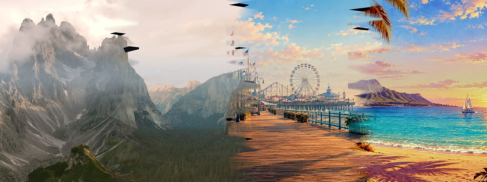
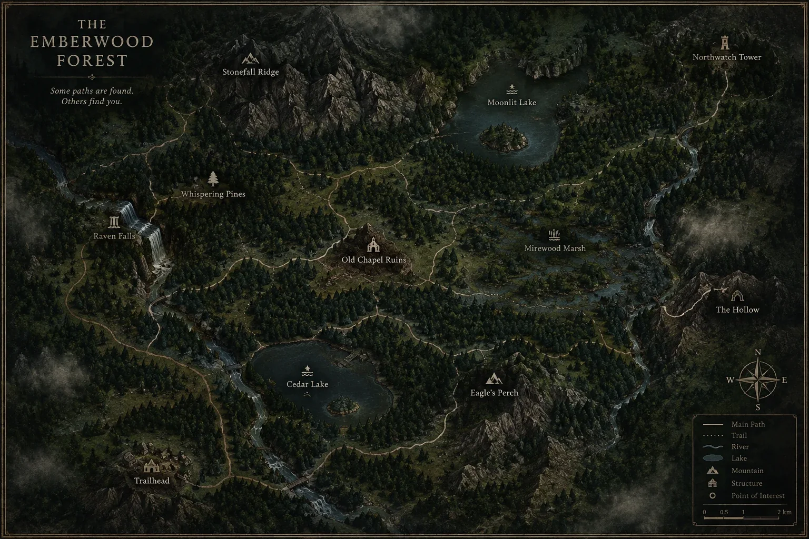
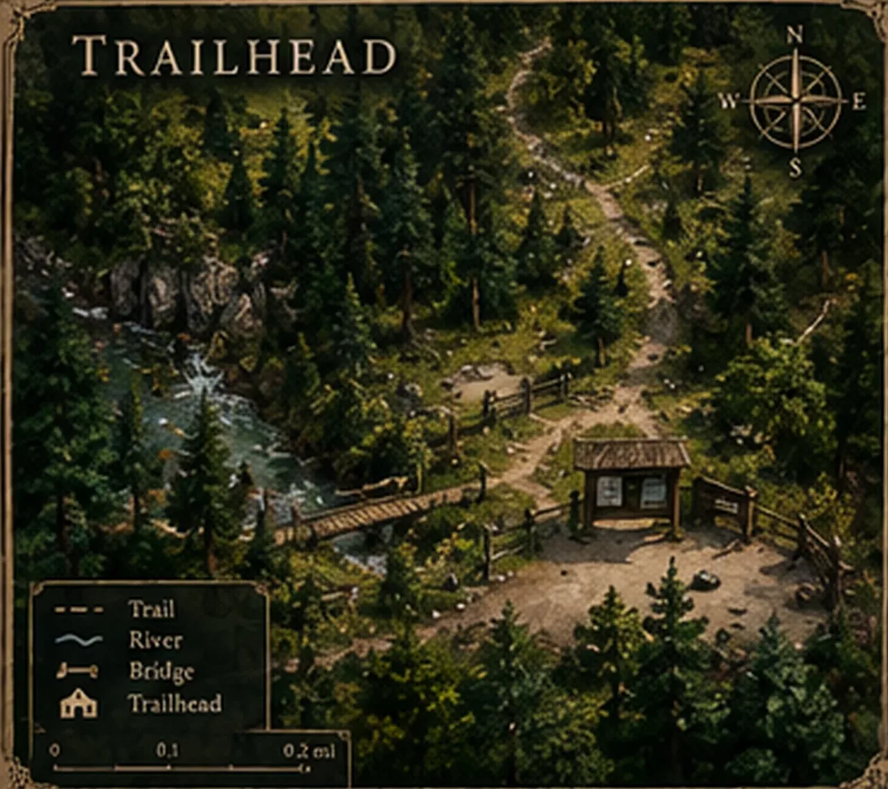
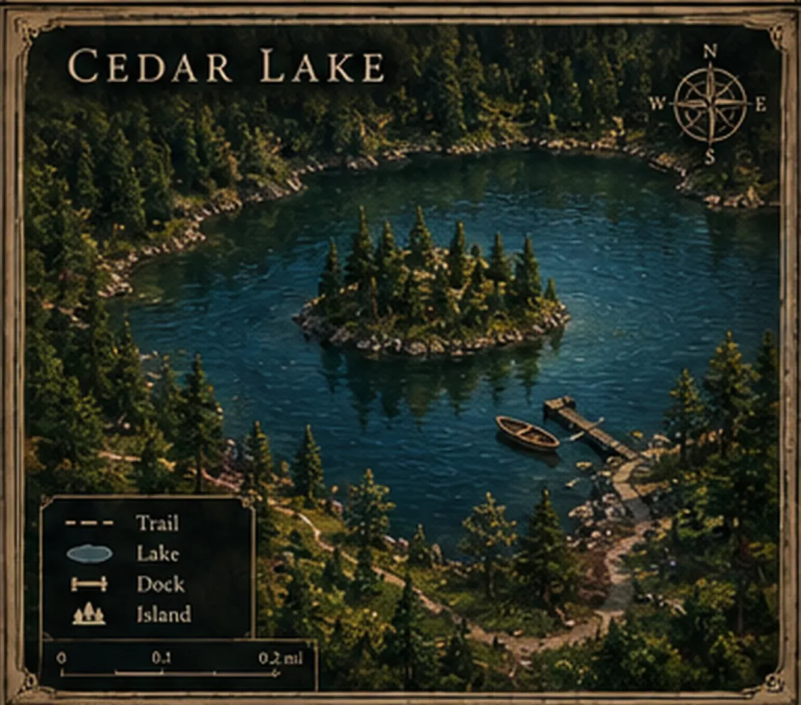
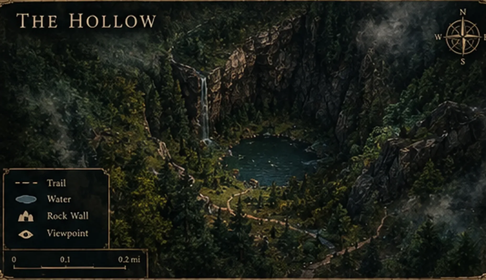

# Visual Design System

## Design Philosophy

**No generic AI tutoring.** This app uses immersive fantasy forest art direction to make SAT/ACT prep feel like an adventure, not a worksheet.

- **Palette:** Sampled from hand-painted clearing artwork (forest greens, earth tones, gold accents)
- **Typography:** Times New Roman throughout (serious, readable, deliberate)
- **Hierarchy:** World → Region → Land → Skill Clearing (cinematic zoom-in navigation)
- **Aesthetic:** Flat poster illustration (WPA parks style), not realistic painting

---

## World Map

The entry point. Students see the full SAT landscape before zooming in.

**Palette:**
- Forest greens: `#2f392e`, `#5d7444`
- Mist: `#c1bdce`
- Parchment: `#f4eddd`

---

## Level 2: Skill Regions

Inside a world, students see 4–6 skill domains on a regional map.

Each domain has a distinct color and location, so students learn the spatial layout of SAT topics.

---

## Level 3: Lesson Clearings

The heart of the experience. Each skill appears as an immersive clearing with real features.

### Trailhead

- Bridge, shelter, trail fork, gravel path
- Markers land ON features ("the log bridge", "the shelter")
- Students see progress: "5/10 toward silver gem"

### Cedar Lake

- Dock, rowboat, island, shore trail
- Water + shoreline setting for Algebra/Functions skills

### The Hollow

- Forest floor, sunken path, trees
- Deep woodland for Reading Comprehension

### Other Clearings

| Clearing | Theme | Questions |
|----------|-------|-----------|
| Eagles Perch | Rocky highlands, peaks | Geometry |
| Mirewood Marsh | Cypress water, wetlands | Statistics |
| Moonlit Lake | Deep water, stars | Functions |
| Northwatch Tower | Fortified tower, ramparts | Integrating Skills |
| Old Chapel Ruins | Stone foundation, arch | Advanced Math |
| Raven Falls | Waterfall, cliff face | Algebra Systems |
| Stonefall Ridge | Alpine, boulder field | Number & Quantity |
| Whispering Pines | Forest grove, canopy | Reading & Writing |

---

## Gem System

When students earn 10 correct answers at a tier, a gem appears.

**Tier Colors (from forest palette):**
- Easy: Gold `#b57d37` → `#d9a93f`
- Medium: Silver `#999999` → `#c0c0c0`
- Hard: Bronze `#8B4513` → `#CD7F32`
- Challenge: Amethyst `#9370DB` → `#BA55D3`

**Visual Feedback:**
- Unfilled gem = "Not started"
- Filled gem = "Earned" (appears with animation)
- Progress label = "5/10 toward next gem"

---

## Typography

**Header:** Times New Roman, bold
**Body:** -apple-system (web safe), fallback to serif
**Code:** Courier New

Everything is deliberately serif-forward to avoid the "generic SaaS app" feel.

---

## Responsive Layout

- **Desktop:** Full clearing map with pod rings (markers + labels on hover)
- **Tablet:** Same, with touch-friendly sizing
- **Mobile:** Clearing still visible, pods vertically stacked on details panel

All text remains readable; no UI chrome clutters the artwork.

---

## What Makes This Work

1. **Consistency:** Same palette, same fonts, same fantasy tone everywhere
2. **Immersion:** Students learn SAT structure by walking through a world, not scrolling lists
3. **Actionable progress:** Gems appear visually; students see "5/10 toward silver" and come back
4. **No clip art:** All artwork is custom or sourced from the same project
5. **Serious, not goofy:** Times New Roman + forest greens feel adult (AP prep, not kids' game)

---

## Design Constraints

- ✓ No bright neon or purple gradients
- ✓ No emoji or casual illustrations
- ✓ No "generic AI tutor" aesthetic
- ✓ No floating glass morphism cards
- ✓ Palette sampled from real artwork, not invented

---

## Future Enhancements

- Parallax scrolling on clearing entry
- Animated gem unlock sequences
- Teacher dashboard map (see all students' progress as pins)
- Dark mode (inverts palette, keeps contrast)
- Animated character traversal (travels per skill cleared)
